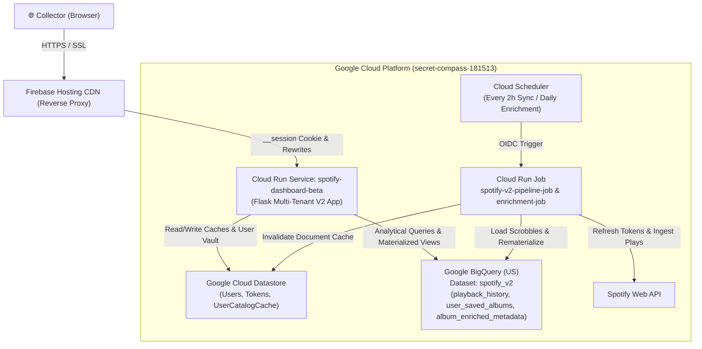

# SpinSleeve

[](https://spinsleeve.cc)
[](https://www.python.org/)
[](https://cloud.google.com/run)
[](https://cloud.google.com/bigquery)
[](https://cloud.google.com/datastore)

---

## 1. Purpose & Mission

**SpinSleeve** (`https://spinsleeve.cc`) is a multi-tenant physical-style virtual vinyl crate, 12" gatefold archival liner notes reader, listening telemetry engine, and friend-to-friend taste compatibility platform.

### High-Level Goals & Mission
* **Digital Curation to Physical Ritual:** Transform flat digital streaming libraries into interactive 12" record crates complete with tactile spinning vinyl platters, album sleeve badges (`🔥 X Plays`), and unowned discovery crates (`"You Should Save These"`).
* **Archival Storytelling:** Unify streaming history with rich editorial context, scraping Wikipedia, Discogs, and Pitchfork reviews to deliver 12" gatefold liner notes, ratings, and personnel rosters.
* **Multi-Tenant Social Lounge (SpinPals):** Enable music collectors to connect, compare hybrid acoustic compatibility scores, and discover top borrow recommendations.
* **Serverless Scale & Data Isolation:** Built on a robust multi-tenant Google Cloud architecture ensuring strict tenant data isolation in BigQuery (`spotify_v2`) backed by blazing-fast Cloud Datastore document caching (`~50ms` loads).

---

## 2. Architecture Topology (Mermaid)



---

## 3. Project File Map

* **`src/report_v2/app.py`:** Production multi-tenant Flask application (`Library Explorer`, `Crate Digger`, `Analytics`, `SpinPals`, and `Admin Control Deck`).
* **`src/pipeline_v2/sync.py`:** Automated multi-tenant synchronization engine ingesting plays and saved albums into BigQuery.
* **`src/pipeline_v2/enrich.py`:** V2 album metadata scraper enriching records with 12" gatefold archival liner notes.
* **`manage_users.py`:** Administrative CLI tool for managing user approvals and permissions.
* **`INFRA_RUNBOOK.md` & `TECHNICAL_SPECS.md`:** Comprehensive infrastructure runbooks and technical specifications.

---

## 4. Operational Commands

### Execute Multi-Tenant Pipeline On-Demand
```bash
gcloud run jobs execute spotify-v2-pipeline-job --region=europe-west2
```

### Execute V2 Album Metadata Enrichment On-Demand
```bash
gcloud run jobs execute spotify-v2-enrichment-job --region=europe-west2 --args="enrich.py,100"
```

### Deploy Updated Beta App
```bash
CLOUDSDK_PYTHON=/Library/Frameworks/Python.framework/Versions/3.10/bin/python3 \
  gcloud builds submit src/report_v2 --tag=europe-west2-docker.pkg.dev/secret-compass-181513/spotify-repo/spotify-dashboard-v2:latest
gcloud run deploy spotify-dashboard-beta \
  --image=europe-west2-docker.pkg.dev/secret-compass-181513/spotify-repo/spotify-dashboard-v2:latest \
  --region=europe-west2
```

---

## 5. License

PolyForm Noncommercial License 1.0.0 — See [LICENSE](LICENSE) for details.
